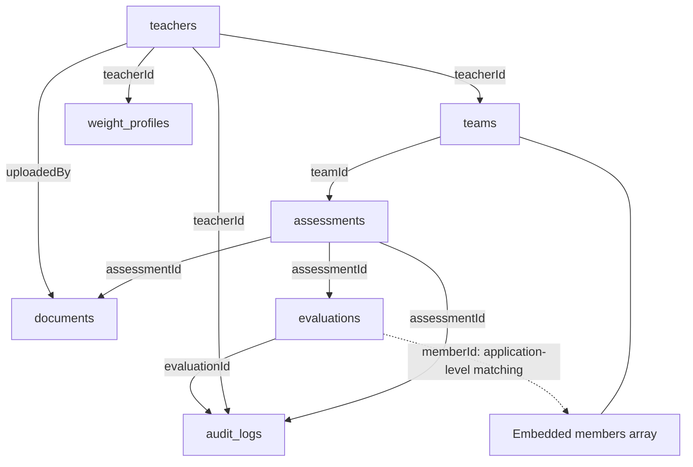

# Contribution Assessment Tool — Database Documentation

> Developer handover | COS40005 — Appraising Individual Contribution in Software Engineering Teams
>
> **Status:** MongoDB Atlas database and initial sample records created; Node.js backend connectivity has been tested by a team member. Full application workflows, authentication and document uploads are not yet confirmed as implemented.

## 1. Overview

The Contribution Assessment Tool helps educators review evidence of individual contributions in software engineering teams. MongoDB stores teacher, team, assessment and evaluation records, along with document metadata, weight profiles and audit history. The application is intended to **support teacher review**, not automatically assign final grades.

| Setting | Value |
| --- | --- |
| Database provider | MongoDB Atlas |
| Atlas project | `Contribution Assessment Tool` |
| Atlas cluster | `ContributionCluster` |
| Database name | `contribution_assessment` |
| Backend | Node.js (team implementation) |
| Frontend | React (team implementation) |
| Data format | BSON documents (JSON-like) |

**Important:** MongoDB is a document database. References between collections are stored as fields and are **not automatically enforced as foreign keys**. Backend code must validate references, access permissions and data consistency.

## 2. Collection summary

Seven collections currently exist:

| Collection | Purpose | Main relationships |
| --- | --- | --- |
| `teachers` | Teacher profiles and identifiers | `_id` referenced by teams, weight profiles, uploads and audit records |
| `teams` | Units, teams, repositories and member lists | `teacherId` → `teachers._id` |
| `assessments` | Assessment instances, sprint, status and configured weights | `teamId` → `teams._id` |
| `documents` | Metadata about supporting files and upload status | `assessmentId` → `assessments._id`; `uploadedBy` → `teachers._id` |
| `evaluations` | Per-member evidence, flags, AI recommendations and teacher decisions | `assessmentId` → `assessments._id`; `memberId` identifies a member |
| `weight_profiles` | Teacher/unit-specific reusable metric weights | `teacherId` → `teachers._id` |
| `audit_logs` | Record of changes and overrides for traceability | `assessmentId`, `evaluationId`, `teacherId` → corresponding documents |

### Logical relationships



The diagram is a **logical model**, not an automatically generated MongoDB schema. Some references, such as member IDs, are application-level identifiers rather than MongoDB `ObjectId` foreign keys.

## 3. Current sample records and fields

The following describes the **initial test documents** created during setup, not a finalized schema or a complete dataset. Examples use placeholder IDs and are not intended to be inserted unchanged.

### `teachers`

One test teacher currently exists. Example fields:

```json
{
  "_id": "ObjectId(...)",
  "name": "Test Teacher",
  "email": "teacher@example.com",
  "ssoSubject": "test-teacher-001",
  "role": "teacher"
}
```

The `ssoSubject` field is **test metadata**; its presence does not mean that SSO or login has been implemented.

### `teams`

One test team currently exists, with **two sample student members**. Relevant fields:

```json
{
  "_id": "ObjectId(...)",
  "unitCode": "COS40005",
  "teamName": "Test Team 01",
  "teacherId": "ObjectId(teacher-id)",
  "repository": { "...": "repository metadata" },
  "members": [
    { "...": "sample student 1" },
    { "...": "sample student 2" }
  ],
  "createdAt": "Date(...)"
}
```

`teacherId` should refer to the actual `_id` of a document in `teachers`. The precise structure of `repository` and `members` should be checked against the current Atlas records and backend implementation before treating it as an API contract.

### `assessments`

One test assessment exists. Relevant fields:

```json
{
  "_id": "ObjectId(...)",
  "teamId": "ObjectId(team-id)",
  "unitCode": "COS40005",
  "sprint": 1,
  "status": "draft",
  "metricWeights": { "...": "four sample metric weights" },
  "documentIds": [],
  "flaggedMembers": 0,
  "teacherConfirmed": false,
  "createdAt": "Date(...)"
}
```

**Note:** `documentIds` is empty in the test assessment even though a separate sample `documents` record exists. Do not assume both directions of the relationship are synchronized until the backend explicitly maintains them.

### `documents`

One **metadata-only** test document exists:

```json
{
  "_id": "ObjectId(...)",
  "assessmentId": "ObjectId(assessment-id)",
  "fileName": "sprint1_contribution_report.pdf",
  "documentType": "contribution_report",
  "fileType": "application/pdf",
  "storagePath": "test/assessment_001/sprint1_contribution_report.pdf",
  "uploadedBy": "ObjectId(teacher-id)",
  "uploadStatus": "pending",
  "createdAt": "Date(...)"
}
```

**There is no actual PDF behind this sample record.** Its `storagePath` is a placeholder, not a valid file location. A retrieval endpoint must not assume that the file exists just because its metadata is present.

### `evaluations`

One sample evaluation exists, associated with the test assessment and one sample member:

```json
{
  "_id": "ObjectId(...)",
  "assessmentId": "ObjectId(assessment-id)",
  "memberId": "student_001",
  "memberName": "Student One",
  "status": "needs_review",
  "evidence": { "...": "four sample evidence arrays" },
  "flags": [],
  "aiRecommendation": { "...": "sample recommendation data" },
  "teacherDecision": null,
  "createdAt": "Date(...)"
}
```

`aiRecommendation` is sample data, not evidence that the AI analysis pipeline is operational. Teacher decisions should remain separate from AI suggestions.

### `weight_profiles`

One default sample profile exists. Relevant fields:

```json
{
  "_id": "ObjectId(...)",
  "teacherId": "ObjectId(teacher-id)",
  "unitCode": "COS40005",
  "profileName": "Default Contribution Assessment",
  "metrics": { "...": "four sample metric weights" },
  "totalWeight": 100,
  "isDefault": true,
  "createdAt": "Date(...)"
}
```

Application validation should ensure the weights total **100** and that assessments preserve the weights actually used for their analysis.

### `audit_logs`

One sample audit record exists, representing a teacher override of an AI recommendation. Relevant fields:

```json
{
  "_id": "ObjectId(...)",
  "assessmentId": "ObjectId(assessment-id)",
  "evaluationId": "ObjectId(evaluation-id)",
  "teacherId": "ObjectId(teacher-id)",
  "action": "recommendation_override",
  "fieldChanged": "aiRecommendation.summary",
  "previousValue": "Available evidence supports the reported contribution.",
  "newValue": "Contribution requires further review of supporting evidence.",
  "reason": "Teacher identified additional evidence requiring verification.",
  "createdAt": "Date(...)"
}
```

The record demonstrates the **proposed audit data structure**; it does not prove that automatic audit logging is already wired into the UI.

